# Database schema

PostgreSQL 18, accessed through Sequelize. **21 tables**, all keyed by UUID,
all carrying `createdAt` / `updatedAt` as `timestamptz`.

This document explains the data model and the decisions behind it. The schema
itself is defined by the 42 migrations in `server/migrations/`, which are the
authority; the Sequelize models in `server/src/models/` mirror them in
TypeScript.

---

## How the tables relate

```mermaid
erDiagram
    Users ||--o{ UserSkills : "claims"
    Skills ||--o{ UserSkills : "is claimed as"
    Skills ||--o{ Skills : "parent of"

    Users ||--o{ Gigs : "posts (client)"
    Skills ||--o{ Gigs : "categorises"
    Gigs ||--o{ GigApplications : "receives"
    Users ||--o{ GigApplications : "applies (worker)"

    Gigs ||--o{ Matches : "is filled by"
    Users ||--o{ Matches : "is matched (worker)"
    MatchWeightProfiles ||--o{ Matches : "ranked under"
    Matches ||--|| Transactions : "is paid by"
    Matches ||--o{ Reviews : "is rated in"
    Users ||--o{ Reviews : "writes / receives"

    Users ||--o{ SkillTasks : "submits (worker)"
    Skills ||--o{ SkillTasks : "is evidenced for"
    SkillTasks ||--o{ SkillTaskAssignments : "is reviewed in rounds"
    Users ||--o{ SkillTaskAssignments : "reviews"
    SkillTasks ||--o{ SkillTaskEvidences : "carries"
    SkillTasks ||--o| SkillTaskAppeals : "may be appealed"

    Users ||--o{ TrustScoreSnapshots : "is scored in"
    Users ||--o{ SkillPassports : "issues"
    Users ||--o{ Notifications : "receives"
    Notifications ||--o{ NotificationDeliveries : "is attempted on"
    Users ||--o{ Messages : "sends / receives"
    Users ||--o{ SurveyResponses : "answers"
    Users ||--o| ExperimentAllocations : "claims an arm"
```



`IdempotencyKeys` is the one table absent from the diagram: it holds no foreign
keys. It is addressed by a `(scope, key)` pair supplied by the caller, not by a
relationship to anything else in the model.

The model divides into five concerns:

| Concern | Tables |
|---|---|
| **Identity and competence** | `Users`, `Skills`, `UserSkills` |
| **Work** | `Gigs`, `GigApplications`, `Matches`, `Transactions`, `Reviews` |
| **Verification** | `SkillTasks`, `SkillTaskAssignments`, `SkillTaskEvidences`, `SkillTaskAppeals` |
| **Trust and portability** | `TrustScoreSnapshots`, `SkillPassports`, `MatchWeightProfiles` |
| **Operations and research** | `Notifications`, `NotificationDeliveries`, `Messages`, `SurveyResponses`, `ExperimentAllocations`, `IdempotencyKeys` |

---

## Identity and competence

### `Users` — 29 columns

One table for all three roles; `role` (`worker` | `client` | `admin`)
discriminates. A separate table per role would duplicate every field that
matters to all of them — location, trust, language, notification preferences —
and complicate the many places where a person is simply a counterparty.

| Column | Type | Notes |
|---|---|---|
| `id` | uuid PK | |
| `name`, `email`, `passwordHash` | varchar | `email` unique |
| `role` | varchar | `worker` \| `client` \| `admin` |
| `status` | varchar | `active` \| `suspended`, default `active` |
| `bio`, `experienceSummary` | text | |
| `locationLat`, `locationLng` | float | Nullable — a worker without a location is scored neutrally, not buried |
| `trustScore` | float | Denormalised from the latest snapshot, default 0 |
| `trustScoreBreakdown` | **jsonb** | The components behind the score (see *Typed JSONB* below) |
| `trustScoreUpdatedAt` | timestamptz | |
| `reviewCount`, `completedJobCount`, `abandonedJobCount` | int | Denormalised counters, recomputed with the score |
| `preferredLanguage` | varchar | `en` \| `rw` |
| `yearsExperience`, `cvUrl`, `certificateUrl` | | Self-reported profile detail |
| `phone`, `smsNotificationsEnabled`, `emailNotificationsEnabled` | | Notification routing |
| `reviewerTier` | varchar, indexed | `admin` \| `peer` \| null — **the capability to review, held independently of `role`** |
| `experimentArm` | varchar, indexed | `provenance` \| `plain` \| null — RQ3 assignment |
| `resetToken`, `resetTokenExpiresAt` | | Password reset |

Two design points worth stating:

**`reviewerTier` is not `role`.** Peer reviewers are workers. Gating review on
the role would restrict the pool to platform staff, and a pool of four admins
cannot rotate — which is precisely the mechanism the verification design rests
on.

**`trustScore` is denormalised on purpose.** The authoritative history lives in
`TrustScoreSnapshots`; this column is a cached current value so ranking a
hundred candidates does not mean a hundred recomputations.

### `Skills` — a two-level tree

| Column | Notes |
|---|---|
| `category` | One of four trades: `electronics_repair`, `tailoring`, `tutoring`, `digital_web` |
| `name`, `description` | |
| `parentId` | Self-FK, indexed. Null for a category, set for a specialisation |
| `kind` | `category` \| `specialisation`, indexed |
| `sortOrder` | Display order within a parent |

A specialisation inherits its parent's `category`, so queries that group or
filter by category keep working unchanged. The tree is **curated, not
worker-authored** — free tagging would destroy the comparability the matching
comparison needs. Currently 4 categories and 22 specialisations.

The depth is deliberately capped at two. It is enough to tell "bridal wear"
from "school uniforms" — which is what lets the scorer distinguish an exact
match from a sibling one — without the maintenance burden of a deep taxonomy.

### `UserSkills` — the competence claim

Unique on `(userId, skillId)`.

| Column | Notes |
|---|---|
| `proficiencyLevel` | 1–5. Only counts against a client's stated requirement when reviewer-set |
| `verificationStatus` | `unverified` \| `pending` \| `verified` |
| `provenance` | indexed — `self_declared` \| `document_sighted` \| `peer_reviewed` \| `work_earned` |
| `provenanceDetail` | **jsonb** — the evidence counts behind the tier |
| `credentialStrength` | float, default 0.15 — the numeric weight the tier carries in ranking |
| `selfDeclaredAt` | |

**`provenance` is the distinguishing column in this schema.** Most marketplaces
store a boolean "verified". Here the same claim carries *how it came to be
recorded*, on an ascending scale, because a signal is only as credible as it is
hard to fake:

| Tier | Established by | `credentialStrength` |
|---|---|---|
| `self_declared` | The worker said so | 0.15 |
| `document_sighted` | A rotated reviewer looked at a document | 0.50 |
| `peer_reviewed` | An approved demonstration task | 0.80 |
| `work_earned` | ≥3 completed, reviewed jobs in that skill | 1.00 |

`self_declared` is deliberately non-zero. A pilot starts with almost nobody
verified, and scoring an unproven worker at zero would make them unrankable —
reproducing the exclusion the platform exists to break.

`credentialStrength` is stored rather than derived from `provenance` at read
time because the matching engine reads it per candidate inside a ranking loop;
a join or a lookup there would be a query per worker.

---

## Work

### `Gigs`

`status` runs `pending_review` → `open` → `matched` → `completed`, with
`cancelled` and `rejected` as terminal branches. A gig is **not** visible when
posted; an admin approves it, which is also what triggers ranked invitations.

`openedAt` is separate from `createdAt` because time-to-first-match has to be
measured from the moment a gig went live, not from when it was submitted and sat
in a queue.

`requiredLevel` (1–5, nullable) is the client's stated bar. It is scored as a
**soft penalty and never used to filter** — filtering hides workers and
reproduces the opacity the project criticises.

`skillId` is `ON DELETE RESTRICT` while nearly every other FK cascades: deleting
a skill that gigs reference would silently destroy work history.

### `Matches` — where the research data lives

| Column | Notes |
|---|---|
| `status` | `pending` \| `accepted` \| `completed` \| `cancelled` |
| `origin` | indexed — `manual` (from an application) \| `ranked` (engine-invited) |
| `invitationReason` | indexed — `ranked` \| `exploration` \| null |
| `rankScore`, `scoreBreakdown` (**jsonb**), `weightProfileId` | The ranking, frozen at invitation time |
| `respondedAt`, `acceptedAt`, `declineReason` | |
| `respondedOccurredAt`, `wasQueuedOffline` | When the worker *acted*, as against when the server heard |

Four columns here exist for measurement rather than for the product:

- **`origin`** separates engine-invited matches from applications, which is the
  comparison the matching evaluation rests on.
- **`invitationReason`** separates a shortlist place the ranking earned from one
  a reserved exploration slot granted. Pooling them would misreport how well
  ranking performs.
- **`scoreBreakdown`** freezes the explanation at invitation time, so a ranking
  stays reproducible after the weight profile is retuned.
- **`respondedOccurredAt`** exists because a six-hour gap in connectivity would
  otherwise be recorded as six hours of hesitation. Both clocks are reported.

`respondedAt` is set **only** by a worker acting on their own match. A client
withdrawing a pending match is not a decline, and must not land in the
denominator of the acceptance rate.

### `Transactions`

Unique on `matchId` (one payment per match), on `reference`, and on
`(provider, providerReference)` — that last one is what makes webhook handling
idempotent: a retried callback finds the existing row instead of creating a
second payment.

The provider's own `providerReference`, `providerStatus` and
`providerRawResponse` (jsonb) are kept alongside the platform's `reference` so a
payment can be reconciled against the provider's records rather than only
against ours, and so a change of provider never rewrites history.

### `Reviews`

Unique on `(matchId, authorId)` — one review per person per match, enforced in
the database rather than trusted to the controller.

---

## Verification

This is the most structured part of the schema, because the integrity claim
depends on it.

### `SkillTasks`

`kind` (`demonstration` | `certificate`, indexed) is the column that lets a
certificate sighting inherit the entire reviewer-rotation apparatus — pairing
limits, quorum, escalation, appeals — instead of needing a parallel subsystem.

`claim` (jsonb) holds what the worker says a certificate is: `{title, issuer,
issuedOn}`. Nothing authenticates it; a reviewer sights it.

`requiredApprovals` (1 or 2) and `disagreementFlag` carry the quorum state.

### `SkillTaskAssignments` — the audit trail

Unique on `(taskId, reviewerId)`: the same reviewer cannot be drawn twice for
one task.

| Column | Notes |
|---|---|
| `round` | Escalation round — initial, quorum, tiebreak, appeal |
| `status` | `pending` \| `approved` \| `rejected` \| `recused` \| `expired` |
| `confidence` | 1–5, self-reported. A low score escalates to a quorum |
| **`assignmentSeed`** | The seed the draw was made with |
| **`eligiblePoolSize`** | How many reviewers were eligible at the time |
| `assignedAt`, `decidedAt` | Timestamps the rubber-stamp detector reads |

`assignmentSeed` and `eligiblePoolSize` are the columns that make the
collusion-resistance claim checkable rather than merely asserted. Any assignment
in the pilot can be replayed from its seed, and the detector only judges
decision speed on rows that carry a seed — rows backfilled before per-round
tracking existed would otherwise read as instant decisions and bury the signal.

### `SkillTaskEvidences`

`kind` is `photo` | `video` | `voice` | `link` | `document`, with `sha256`,
`sizeBytes`, `durationSec` and `capturedAt`. The hash ties a reviewer's decision
to the exact bytes they saw.

The kind is **declared by the client, not sniffed from the mime type**: a JPEG
can be a photo of finished work or a photo of a certificate, and only the
uploader knows which.

### `SkillTaskAppeals`

Unique on `taskId` — one appeal per submission. Upholding one reassigns the task
while excluding every reviewer who has already seen it.

---

## Trust and portability

**`TrustScoreSnapshots`** — immutable history. Each row holds the `score`, the
whole breakdown (jsonb), the `formulaVersion` and the `trigger` that caused the
recomputation. Versioning the formula is what lets scores computed under
different versions be told apart afterwards instead of being silently compared.

**`SkillPassports`** — stores only `tokenId`, never the token, so the row cannot
be used to impersonate the passport it identifies. Revocation is a `revokedAt`
timestamp rather than a delete, because a verifier needs to be told a passport
was *withdrawn*, not merely that it is unknown.

**`MatchWeightProfiles`** — named weightings (`balanced`, `proximity_first`,
`trust_first`, `credential_first`) with `distanceHalfLifeKm` and `maxDistanceKm`.
`weights` is jsonb and deliberately open-ended: a profile may carry a key this
version of the scorer does not compute, and the scorer drops it rather than
contributing `NaN` to every total.

---

## Operations and research

**`Notifications` / `NotificationDeliveries`** — one delivery row per channel per
attempt, including the ones where nothing was sent. `status` includes `skipped`
alongside `sent` and `failed`, because a pilot reporting delivery has to tell
"this worker did not want SMS" apart from "we tried and it failed". Indexed on
`(channel, status)`.

**`ExperimentAllocations`** — the pre-generated RQ3 randomisation list. Unique on
`(experiment, position)`, with a covering index on
`(experiment, claimedByUserId, position)` so claiming the next free arm is one
indexed lookup under `FOR UPDATE SKIP LOCKED`.

Rows carry `blockIndex`, `blockSize`, `arm` and the generating `seed`. The whole
sequence is fixed **before** recruitment: with a fixed block size the last entry
of each block is deducible, so block sizes are mixed (2 and 4). Allocation is
claimed atomically rather than computed at registration, because a
count-then-write approach races and silently breaks the balance it exists to
guarantee.

**`IdempotencyKeys`** — unique on `(scope, key)`. The uniqueness constraint *is*
the lock: two simultaneous arrivals race at the database rather than in
application code, exactly one insert wins, and the loser is told to retry.
`responseBody` (jsonb) stores what the first attempt answered so a replay
returns the same response rather than a fresh, differently-shaped success.

**`SurveyResponses`** — Likert 1–7 with a free-form `context` (jsonb) that
records the respondent's experiment arm.

---

## Cross-cutting decisions

### Enums are `VARCHAR` with validators, not `DataTypes.ENUM`

Every closed set — `role`, `status`, `provenance`, `origin` — is a `VARCHAR`
with a Sequelize `isIn` validator, and a matching TypeScript union in
`server/src/types/domain.ts`.

Postgres enums require a migration to add a value and lock the type while doing
it. On a schema that gained `exploration`, `certificate` and four provenance
tiers during development, that would have meant a type-altering migration each
time. The cost is that the database will accept an out-of-range string written
outside the application, which is why the validators are kept rather than
replaced by the TypeScript types.

### Typed JSONB

Ten JSONB columns. Three of them hold a service's return value verbatim, and
since the TypeScript migration the producer and the column share one declared
type, so they cannot drift apart unnoticed:

| Column | Type | Produced by |
|---|---|---|
| `Matches.scoreBreakdown`, `GigApplications.scoreBreakdown` | `ScoredPair` | `matchScoringService.scorePair` |
| `Users.trustScoreBreakdown`, `TrustScoreSnapshots.components` | `TrustBreakdown` | `trustScoreService.recalculate` |
| `UserSkills.provenanceDetail` | `ProvenanceDetail` | `competenceService.recalculate` |
| `MatchWeightProfiles.weights` | `Record<string, number>` | Open by design |
| `SkillTasks.claim` | `SkillTaskClaim` | User-supplied |
| `Transactions.providerRawResponse` | `unknown` | Genuinely the provider's shape |
| `IdempotencyKeys.responseBody` | `Record<string, unknown>` | Any controller's response |
| `SurveyResponses.context` | `Record<string, unknown>` | Free-form |

JSONB rather than normalised tables because these are **explanations, not
entities**: nothing joins to a score component, the shape changes with the
formula version, and a `components` table would need its own migration every
time the scorer gained an input.

### Denormalised counters

`Users.trustScore`, `reviewCount`, `completedJobCount` and `abandonedJobCount`
duplicate what could be aggregated from `Reviews` and `Matches`. They are
recomputed together in one place — `trustScoreService.recalculate` — and the
authoritative history stays in `TrustScoreSnapshots`. The alternative is
aggregating over every review and match for each of a hundred candidates inside
a ranking request.

### Deletion

Nearly every foreign key cascades from `Users`, so deleting an account removes
the rows that belong to it. Three exceptions are deliberate:

- `Gigs.skillId` → **RESTRICT**: a skill with work attached cannot be deleted.
- `SkillTasks.reviewerId`, `SkillTaskAppeals.decidedBy` → **SET NULL**: the task
  and its decision survive the reviewer's account.
- `Matches.weightProfileId`, `GigApplications.weightProfileId` → **SET NULL**:
  retiring a weight profile must not delete the matches ranked under it. The
  frozen `scoreBreakdown` still records what the weights were.

---

## Working with the schema

```bash
cd server
npm run migrate          # apply
npm run migrate:undo     # roll back the last one
npm run seed             # reference data + demo history (run once)
```

Migrations are plain JavaScript in `server/migrations/` even though the
application is TypeScript: `sequelize-cli` loads them itself and cannot execute
`.ts`. They are excluded from the TypeScript program for that reason.

To inspect the live schema:

```bash
psql -U isoko -d isoko_talents_dev -c '\d "Users"'
psql -U isoko -d isoko_talents_dev -c '\dt'
```
